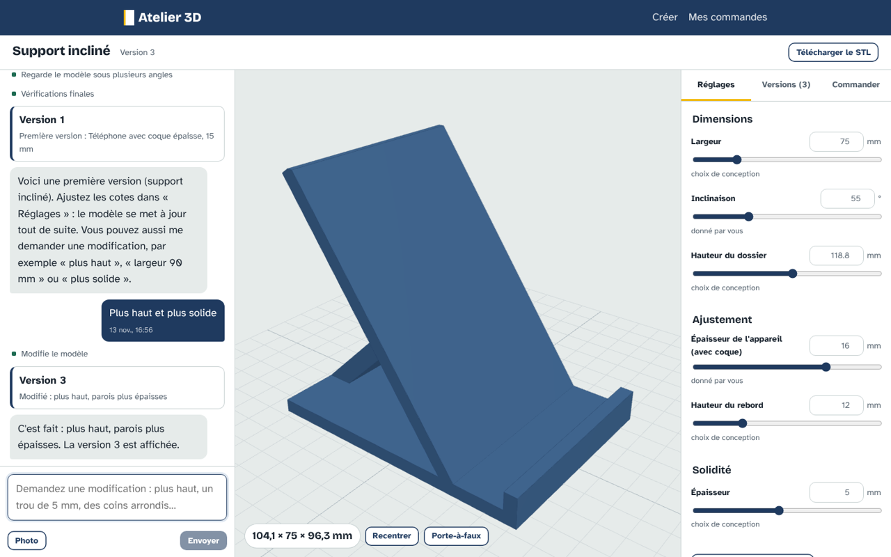

# IaModelize3d

Décrivez un objet ou photographiez une pièce : l'IA vous pose les bonnes questions, le conçoit en 3D, vous l'ajustez
vous-même (cotes, versions), puis vous le téléchargez ou le faites imprimer par l'atelier, avec un prix en FCFA et un
paiement Mobile Money.

Les captures des écrans sont dans [`docs/interfaces/`](docs/interfaces/README.md).



## Ce que contient le dépôt

| Dossier | Rôle |
| --- | --- |
| `apps/repair-web/` | **le front** (React + TypeScript) : accueil « Que voulez-vous créer ? », studio (discussion avec l'IA, modèle 3D, réglages, versions), commandes, tableau de l'atelier — voir son README |
| `server/iamodelize3d/` | l'API (Python, FastAPI) : projets, agent concepteur, boutique (devis, paiement, impression, contrôle qualité) |
| `server/scripts/g1_demo.py` | l'API en démonstration, sans clé d'IA |
| `packages/geom/` | le noyau géométrique (manifold en WebAssembly), utilisé par le navigateur et par le serveur |
| `packages/pcb/` | le pipeline de circuits imprimés (pour les appareils électroniques, pas encore dans le nouveau front) |
| `web/` | l'ancien front (SvelteKit) hérité de Formwright, en anglais, conservé comme référence |
| `deploy/` | déploiement par conteneurs |

## Démarrer

```bash
npm install                                         # à la racine : le noyau géométrique
cd server && python3 -m venv .venv && .venv/bin/pip install -e ".[dev]"
.venv/bin/python scripts/g1_demo.py                 # API de démonstration, port 8400
# dans un autre terminal
cd apps/repair-web && npm install && npm run dev    # http://localhost:5410
```

Avec une vraie IA, copiez `.env.example` en `.env` et réglez au minimum `FW_LLM_PROVIDER` et sa clé
(`META_API_KEY` ou `FW_LLM_API_KEY`), puis `FW_SHOP_TARIFF=cm` pour les prix en FCFA. Les variables d'environnement
gardent le préfixe `FW_` hérité de Formwright.

## Tests

```bash
cd server && .venv/bin/python -m pytest -q tests --ignore=tests/test_meta_live.py --ignore=tests/test_vision_live.py
cd apps/repair-web && npm run build
```

## Origine et licence

IaModelize3d est dérivé de **Formwright**, créé par Roman (Axo) pendant le Meta Global AI Developer Hackathon
(octobre–novembre 2026) : https://github.com/Romanok2805/formwright. Son README d'origine est conservé dans
`docs/FORMWRIGHT_README.md`.

Le code de Formwright est publié sous la licence PolyForm Noncommercial 1.0.0 (`LICENSE`). Son auteur a autorisé
par écrit l'usage commercial et la modification de son code pour ce projet ; voir `NOTICE`.
