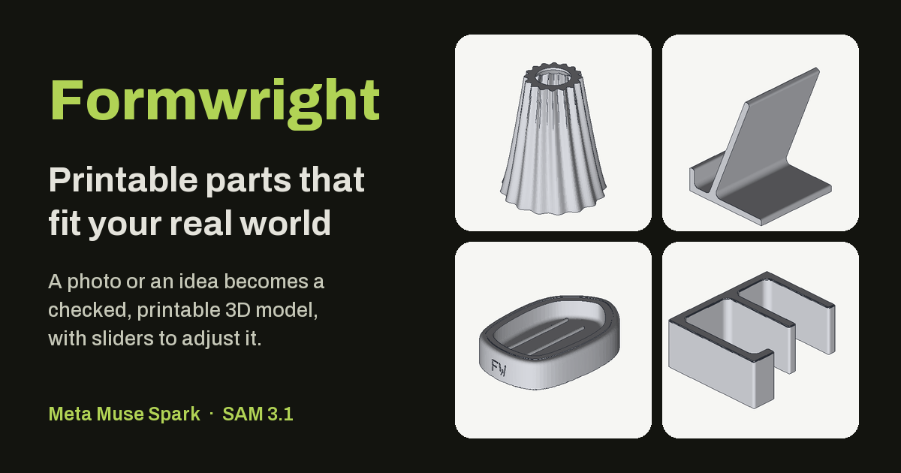
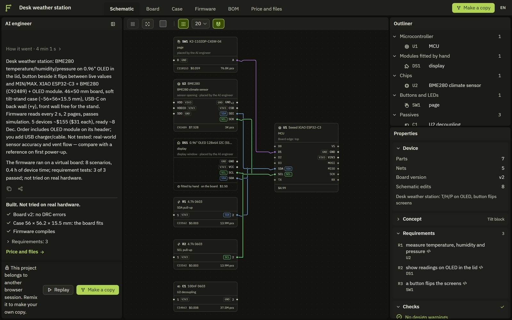
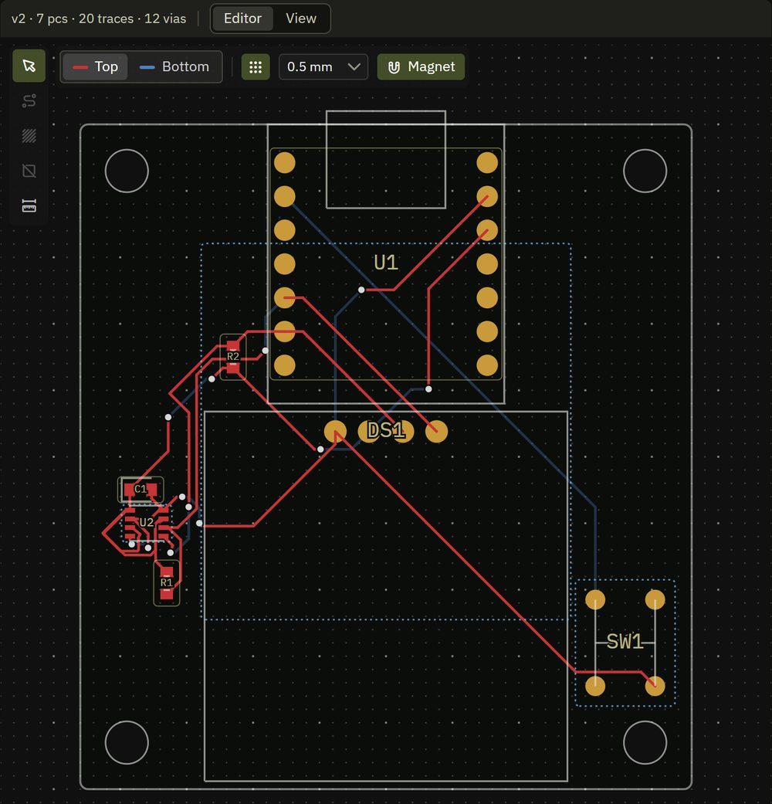
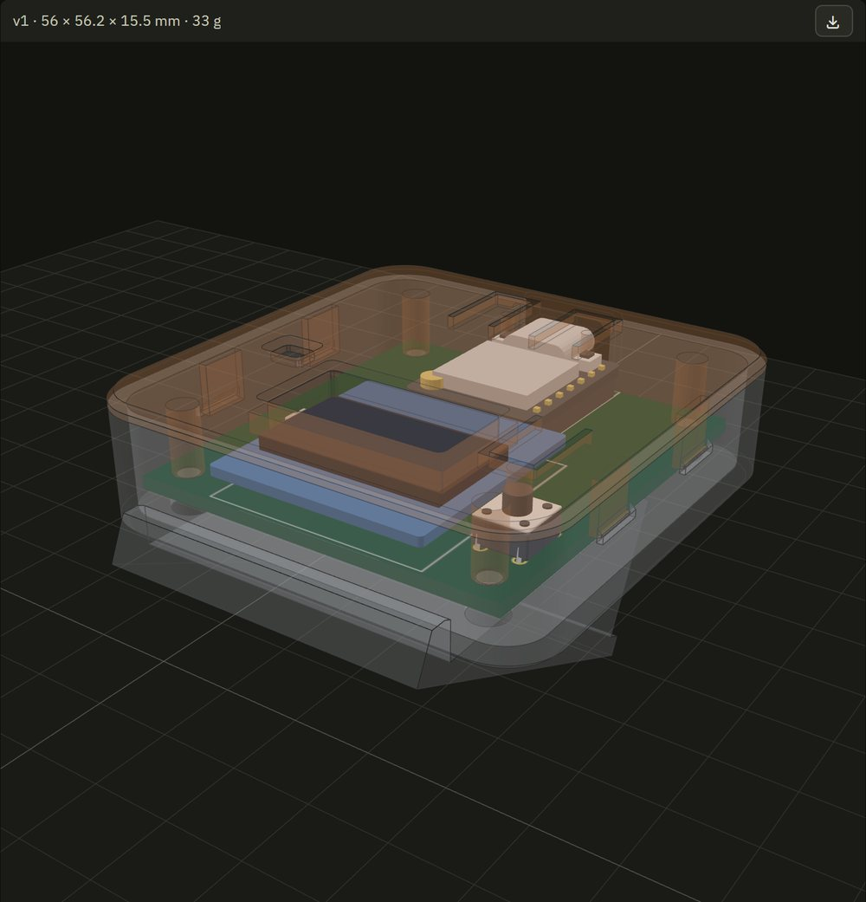
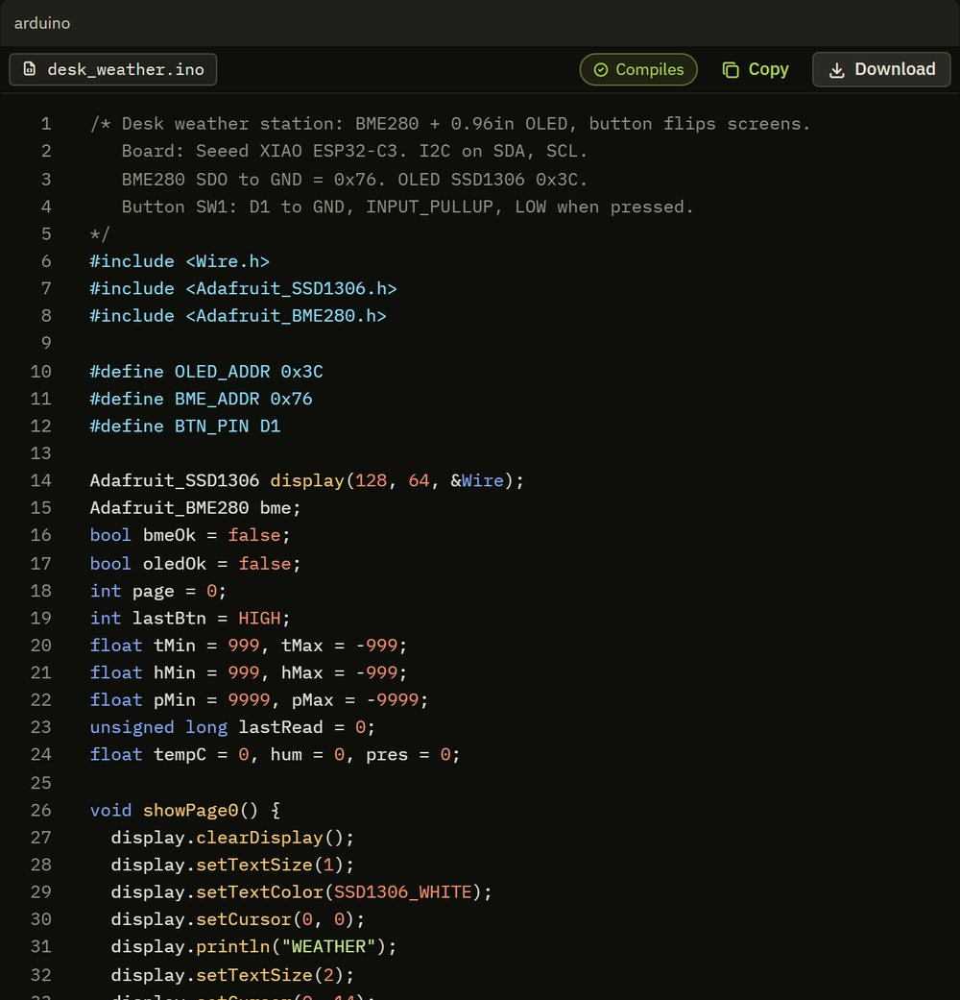
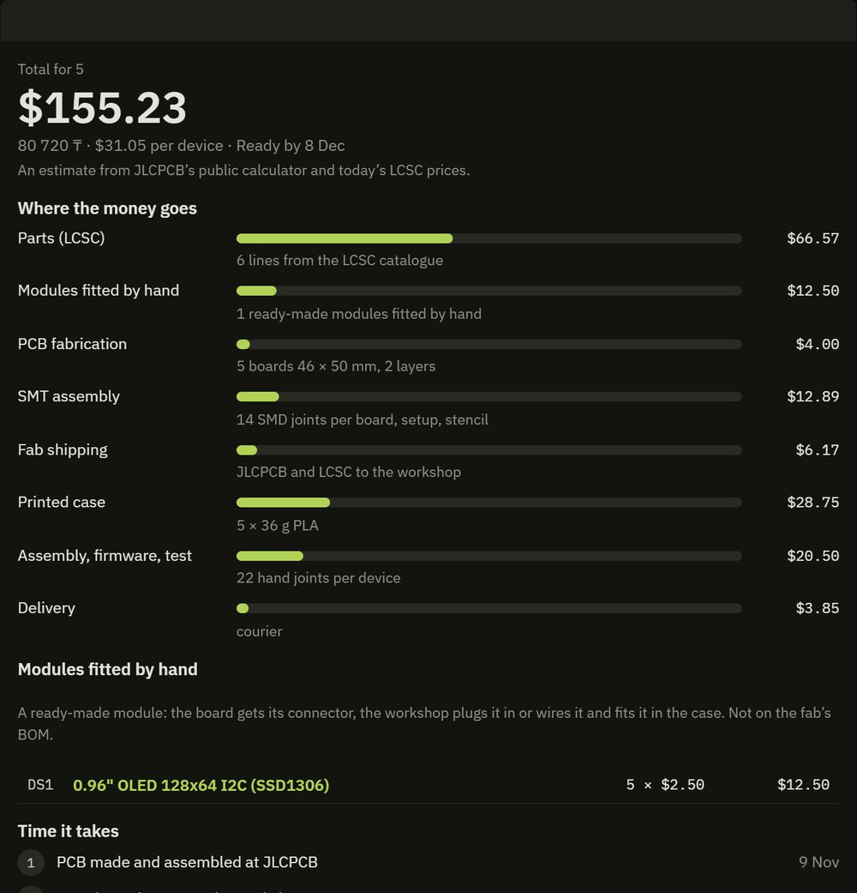
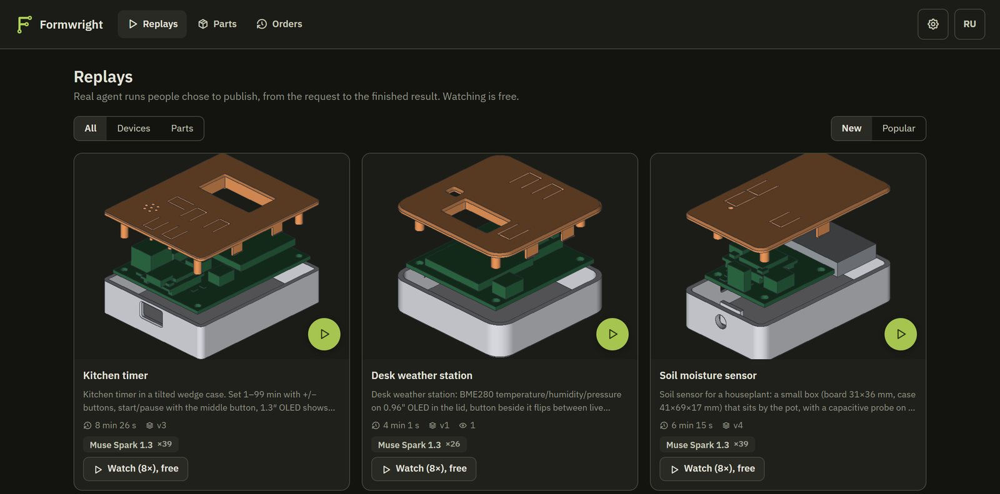

# Formwright

[](https://formwright.axo.kz)
[](https://formwright.axo.kz/replays)
[](#meta-models)
[](#built-during-the-hackathon)
[](#built-during-the-hackathon)
[](LICENSE)
<br>




**Formwright by Axo is hardware R&D from a sentence to a box on your desk: describe a device and get it finished —
real parts from the LCSC catalogue wired in a node editor, a placed and routed board, its 3D-printed case and its
firmware — then order it built. The same agent prints the spare part nobody stocks.**

Under it is an agent that turns descriptions, photos, caliper readings, sketches and voice notes into things that can
be made (whole devices, spare parts, cases for electronics boards) and checks each one against reality before
anything is ordered. Dimensions come from measurement, standards tables and official specs, not from guessing: the
agent writes a short parametric program, a geometry kernel builds it, and a slicer-like check goes over every version.
A printed part also passes an independent critic. A device has to pass electrical and design rules, and its firmware
runs against its own circuit on a virtual board; the model's "done" is not accepted until those checks are.

**[Live app](https://formwright.axo.kz)** · **[Watch real runs](https://formwright.axo.kz/replays)** · Startups track ·
Push the Frontier · Built 27 Oct – 4 Nov 2026 for the Meta Global AI Developer Hackathon

## One real run

A desk weather station from a sentence, 4 min 1 s on Muse Spark 1.3. **[Watch this run](https://formwright.axo.kz/w/p_e5e1c9de167c48fd)**
in the browser, from the request to the result.



**Schematic.** Real LCSC parts with price and stock, wired in a node editor, next to the agent's chat.

| | |
|---|---|
|  |  |
| **Board.** Placed and routed on two layers, editable by hand. | **Case.** Made from that board, with an opening for each part. |
|  |  |
| **Firmware.** A sketch for the exact pins, run on a virtual board. | **Price.** A batch of five with every cost, dates and the fab's files. |



**[Replays](https://formwright.axo.kz/replays).** More real runs, free to watch.

## Features

- **Devices from a description.** “A weather station with an OLED display and Wi-Fi” becomes a device graph: the
  agent searches the live LCSC catalogue (JLCPCB's parts search: stock, price breaks, basic/extended), reads every
  chip's real pinout and footprint from EasyEDA, picks a module (XIAO ESP32-C3/S3, Pico, Pico W) and the chips around
  it, and wires parts and nets with pull-ups and decoupling. No coordinates are written by the model: a deterministic
  compiler places connectors and the module's USB on their edges, lets tscircuit pack the rest next to the pins it
  connects, autoroutes two layers, runs DRC and intent checks and grows the board until it routes. Then the snap-fit
  case and firmware for the exact pins.
- **Order it from one page.** A BOM with LCSC numbers and a price for a batch of N: parts, ready-made modules, PCB, SMT
  assembly, shipping by weight on JLCPCB's real lines to Kazakhstan, the printed case and hand assembly, with dates.
  The batch goes to the [Axo](https://axo.kz) shop's cart at that price; delivery and payment are the shop's, and the
  workshop's order carries the fab files, the case, the firmware and a work order as one archive. A device with DRC
  errors, a changed schematic, an old case or no firmware is refused before it gets there. A person at the workshop
  orders the boards: this step is not automated.
- **Firmware on a virtual board.** An Arduino sketch for the XIAO compiles to WebAssembly and runs against a DC model
  of the device's own circuit, on a virtual clock. Each requirement can carry a scenario (what the person does, what
  must happen). A test that passes without its steps is refused, one changed after failing is named in the result, and
  a call the board does not model stops the run as "not simulated", never as a pass.
- **Node editor.** The device is a graph you can see and change: parts as nodes with their pins, signal nets as wires,
  supplies as labels; drag a wire between two pins, add any LCSC part by number or function, change values, edges and
  nets in the inspector, then rebuild the board without the agent. The agent and the editor edit the same document
  (`fw.device/1`), so the next request keeps the person's changes.
- **Replays.** A finished run plays back in the browser with nothing spent: pause, speed up, seek, link to a moment,
  with the chat, schematic, board and case as they were then. Owners choose private, link or gallery.

<details>
<summary><b>All other features</b>: electrical rules, cases, hand routing, spare parts, Snap &amp; collect, measurement from photos</summary>

- **Electrical rules.** Current on each net sets trace widths (IPC-2221) and is checked against connector and part
  ratings; unwired measuring inputs, modules on the wrong supply and mains on the board are errors. About 25 ready-made
  modules (e-paper, TFT, I2S speaker, RTC, RFID, GPS, LoRa, stepper driver and more), MX and Choc key switches with
  printed keycaps, screw terminals and panel connectors.
- **Cases that stand somewhere.** Tilted stands, wall ears, straps, lanyards, stakes and magnets from the same engine;
  every port and button is checked against the real board.
- **Placement and routing by hand.** On the board, drag and turn parts (they stay pinned), draw traces pad to pad with
  45/90 degree corners, vias and widths on both layers, delete autorouted traces or keep the good ones. "Route the
  rest" builds again: hand traces go in as fixed `pcbPath` traces, the autorouter joins only what is left around them,
  DRC checks everything. The agent sees what the person changed and keeps their placement and traces.
- **Spare parts (Formwright Parts).** A photo of the broken part on an A4 sheet, the appliance's rating plate and a
  voice note become an order: the intake reads and refuses what is dangerous to print, the agent designs a compatible
  part from the measured photo, OrcaSlicer gives a binding quote in tenge, the farm prints it, and a QC photo is
  compared with the model before it ships. Every verified part becomes a catalog card that can be reordered.
- **Cases for boards.** A photo of a board is matched to a 13-board dataset (`fw.board/1`); the case is checked with
  rays through every port, press tabs over the buttons and snaps that must not overbend.
- **Boards from a description.** tscircuit in a sandboxed worker: placement, autorouting, DRC and intent checks,
  Gerber/BOM/pick-and-place, and a case around the routed board.
- **Snap & collect.** On a phone, tap anything (a bench, a statue, a cat): it becomes a 3D sticker in about a second,
  and six finds print on one plate.
- **Measurement from photos.** SAM 3.1 finds the part and a known reference (A4/Letter sheet, bank card, coin);
  outlines and holes come out in millimetres with an uncertainty. Caliper displays are read directly.
- **Parametric programs and a mesh engine.** Each model is a JavaScript program with sliders, or a mesh document for
  organic shapes. The same code runs in the browser for live editing and in a sandboxed server worker.
- **Checks.** A layer-by-layer mini-slicer reports islands, bridges, overhangs and thin features; for printed parts the
  critic sees renders and the model over the photo, never the code. The agent reads its own pictures with a labelled
  grid in real millimetres and collages of what it made.
- **Output.** STL and 3MF with print settings, Gerber, BOM and pick-and-place files, one archive for a whole device,
  orders through Formwright Parts and the Axo cart, and a Telegram bot.

</details>

## What it does not do yet

- The devices here were checked by rules and on the virtual board. **The firmware has not run on these boards in
  hardware**, which the example runs say in their own words; simulation has no real analog behaviour, RF or library
  internals, and covers Arduino on the XIAO only.
- The tests a model writes for its own firmware can be shallow. The checks make them hard to fake, not deep.
- The case is a box with the right openings: no rails, gears, load-cell mounts, heatsinks or vents, so a device that
  needs them comes back as electronics only. One board per project.
- Modules on headers keep wearable devices large: the agent has not chosen a bare MCU in our runs.
- Prices are estimates from JLCPCB's public calculator and today's part prices; the fab's checkout price is binding.

## Meta models

| Model | Role |
|---|---|
| Muse Spark 1.3 | designer (devices from a description, their parts, nets and firmware), spare-part intake and refusals, circuits, board identification, caliper reading, dimension search |
| Muse Spark Open (open weights, Baseten) | independent critic of printed parts, classification, the English layer, second opinion on spare-part requests; can also design whole devices, picked in the composer |
| Muse Wonder | designer for hard parts |
| SAM 3.1 | measurement, board scan, Snap stickers, face blur, QC of printed parts |
| Muse Spark 1.2 | video understanding |
| Muse Voice Transcribe | voice notes |
| Muse Image | concept images and drawn edits |

The open model never decides a refusal: in the shop it can only hold an order for the operator. Self-hosting
instead of Baseten: Muse Glimmer on Modal, `infra/modal_glimmer.py`.

## Built during the hackathon

All code in this repository was written during the building period; the first commit is `bd5ab1b` (27 Oct 2026,
11:01 ET). What existed before is Axo ([axo.kz](https://axo.kz)), the founder's 3D-printing business in Kazakhstan:
its farm, its customers and its own code, none of which is here. `integrations/axo.py` sends designs to Axo's shop. The
small part of Axo's shop that receives them (a partner route and a cart page, in Axo's own private repository) was
written during the event too; the rest of that shop is older.

Not ours: the open-source libraries in the `package.json` files and `server/pyproject.toml` (among them tscircuit with
its EasyEDA converter, and Svelte Flow for the node editor); part data, stock and prices read live from JLCPCB's parts
search and EasyEDA's component library; OrcaSlicer, run as an external CLI; the IBM Plex fonts and Tabler Icons
(`web/static/fonts/NOTICE.md`); the board dimensions in `packages/geom/src/boards.json`, taken from the manufacturers'
published drawings (each board links its source).

## Architecture

```
 browser (SvelteKit, three.js)              server (FastAPI, SQLite)
 ┌─────────────────────────────────┐  SSE  ┌─────────────────────────────────────────────┐
 │ studio: chat, 3D view, sliders, │◄──────│ agent loop (Muse Spark / Wonder, tools)     │
 │ device node editor (Svelte Flow)│       │  ├ packs: household … enclosure, pcb, device│
 │ handles, photo AR, PCB tab,     │       │  ├ device graph -> compiler -> board, quote │
 │ board editor, replay player     │       │  ├ catalogue: LCSC (JLCPCB search, EasyEDA) │
 │ board ghost and port rays       │       │  ├ firmware: checks, virtual board (WASM)   │
 │ /parts /orders /ops (Axo farm)  │       │  ├ vision: SAM 3.1, calibration, board scan │
 │ /snap /collection /replays      │       │  ├ critic: renders + photos, no code        │
 │ geometry workers (same code) ───┼──┐    │  ├ memory: interfaces, lessons, skills      │
 └─────────────────────────────────┘  │    │  └ printing: Orca CLI, profiles, probes     │
                                      │    │ shop: intake, quotes, orders, QC, catalog   │
     packages/geom (TypeScript)       │    │ sandboxed Node workers (vm + permissions):  │
     manifold kernel, lib.elec,       ├────┤  ├ geometry: packages/geom                  │
     checks, renderer, 3MF export ────┘    │  └ PCB: packages/pcb (tscircuit bundle)     │
                                           └─────────────────────────────────────────────┘
```

## Running locally

Required:

- Node 24
- Python 3.12+
- a Meta Model API key

Optional, for these features only:

- g++: the compile step of the firmware check
- OrcaSlicer 2.4.2: slicing and binding quotes for spare parts
- ffmpeg: audio and video uploads

Copy `.env.example` to `.env` and set `META_API_KEY`; the other settings are listed there.

Windows, API on port 8400 and the web app on http://localhost:5400:

```powershell
.\dev.ps1            # the first run installs npm and Python dependencies and builds the PCB worker
```

By hand:

```bash
npm install
cd packages/pcb && npm ci --ignore-scripts && npm run bundle && cd ../..   # the sandboxed PCB worker
cd server
python -m venv .venv && .venv/Scripts/pip install -e ".[dev]"            # .venv/bin/pip on Linux/macOS
.venv/Scripts/python -m uvicorn formwright.app:app --port 8400
npm run dev                                                               # second terminal, repo root
```

On a VPS with HTTPS (Docker and a domain pointing at the server):

```bash
cd deploy && cp .env.template .env && chmod 600 .env   # FW_DOMAIN, META_API_KEY, FW_OPEN_*
docker compose up -d --build
bash smoke.sh https://your.domain
```

## Tests

```bash
npm test                                     # geometry kernel, checks, cases and port rays, stickers, sandbox
cd packages/pcb && npm test                  # the PCB pipeline
cd web && npm test                           # web helpers
cd server && .venv/Scripts/python -m pytest  # vision, printing, agent, shop, PCB, sessions, quotas
```

The server tests stub the models. `tests/test_vision_live.py` and `tests/test_meta_live.py` (with
`FW_LIVE_TESTS=1`) call the real API.

## License

Source-available under [PolyForm Noncommercial 1.0.0](LICENSE): free for judging, personal, research and education
use; commercial use needs permission. Models you create with Formwright are yours.
