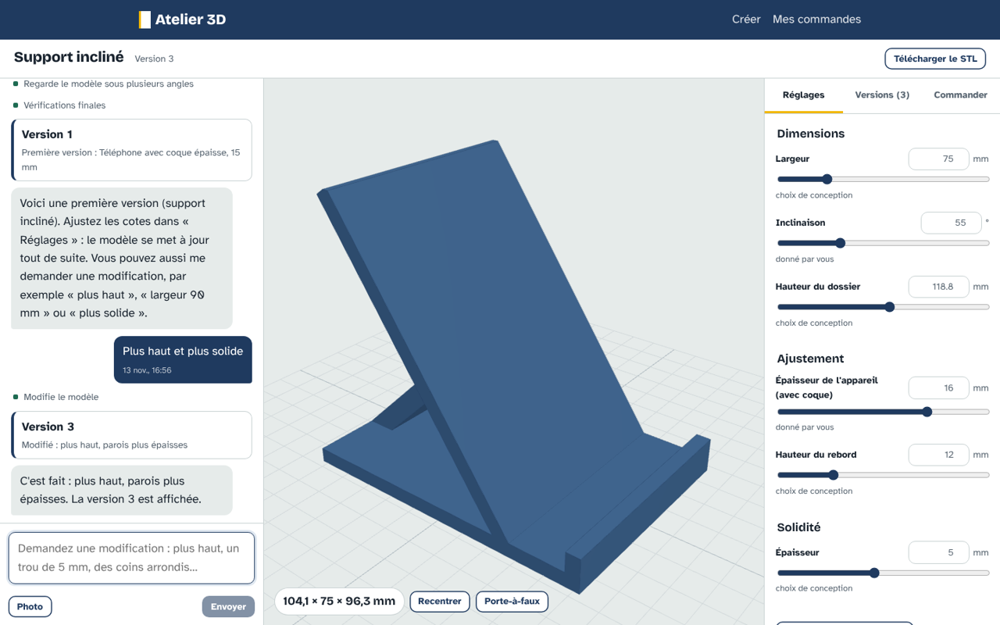

# IaModelize3d

Décrivez un objet ou photographiez une pièce : l'IA vous pose les bonnes questions, le conçoit en 3D, vous l'ajustez
vous-même (cotes, versions), puis vous le téléchargez ou le faites imprimer par l'atelier, avec un prix en FCFA et un
paiement Mobile Money.

L'interface est en **français et en anglais** (sélecteur FR / EN dans l'en-tête). Les captures des écrans sont dans
[`docs/interfaces/`](docs/interfaces/README.md).



## Ce que contient le dépôt

| Dossier | Rôle |
| --- | --- |
| `apps/repair-web/` | **le front** (React + TypeScript) : accueil « Que voulez-vous créer ? », studio (discussion avec l'IA, modèle 3D, réglages, versions), commandes, tableau de l'atelier — voir son README |
| `server/iamodelize3d/` | l'API (Python, FastAPI) : projets, agent concepteur, boutique (devis, paiement, impression, contrôle qualité) |
| `server/scripts/g1_demo.py` | l'API en démonstration, sans clé d'IA |
| `packages/geom/` | le noyau géométrique (manifold en WebAssembly), utilisé par le navigateur et par le serveur |
| `packages/pcb/` | le pipeline de circuits imprimés (pour les appareils électroniques, pas encore dans le nouveau front) |
| `web/` | l'ancien front (SvelteKit) hérité de Formwright, en anglais, conservé comme référence |
| `deploy/` | déploiement par conteneurs |

## Démarrer

```bash
npm install                                         # à la racine : le noyau géométrique
cd server && python3 -m venv .venv && .venv/bin/pip install -e ".[dev]"
.venv/bin/python scripts/g1_demo.py                 # API de démonstration, port 8400
# dans un autre terminal
cd apps/repair-web && npm install && npm run dev    # http://localhost:5410
```

## Lancer en local (Windows)

Double-cliquez sur `lancer-local.cmd` (démo, IA simulée) ou lancez `lancer-local.cmd -Ia` (vraie IA, fichier `.env`).
Le guide complet est dans [`LANCER-EN-LOCAL.md`](LANCER-EN-LOCAL.md).

## Brancher une vraie IA

La démo (`g1_demo.py`) simule l'IA. Pour la vraie, créez un fichier `.env` à la racine du dépôt (modèle complet :
`.env.example`). Exemple avec OpenAI :

```ini
FW_LLM_PROVIDER=openai
FW_LLM_API_KEY=sk-...
FW_LLM_MODEL=gpt-5-mini          # un modèle de votre compte, pour tous les rôles
FW_LLM_PRICE_IN_PER_M=0.25       # prix du modèle en USD par million de jetons, pour que le budget compte
FW_LLM_PRICE_OUT_PER_M=2.00
FW_DAILY_BUDGET_USD=2            # plafond de dépense par jour, tous utilisateurs
FW_SHOP_TARIFF=cm                # prix en FCFA
```

Le nom du modèle et ses prix sont ceux de votre compte (page des tarifs du fournisseur) : vérifiez-les avant de lancer.
Avec Meta : `FW_LLM_PROVIDER=meta` et `META_API_KEY=...` suffisent. Avec un autre service compatible (passerelle,
modèle hébergé) : `FW_LLM_PROVIDER=custom` et `FW_LLM_BASE_URL=https://.../v1`. Les variables gardent le préfixe `FW_`
hérité de Formwright.

Vérifiez la configuration avant de lancer (cinq petits appels, une fraction de centime) :

```powershell
cd server
.\.venv\Scripts\python.exe scripts\check_llm.py     # Linux/macOS : .venv/bin/python scripts/check_llm.py
```

Puis lancez le vrai serveur à la place de la démo :

```powershell
.\.venv\Scripts\python.exe -m uvicorn iamodelize3d.app:app --port 8400
```

Hors Meta, trois fonctions sont coupées : la mesure automatique de la pièce sur la feuille A4 (SAM), les notes vocales et
la génération d'images ; le concepteur demande alors les cotes qu'il ne peut pas lire sur la photo. Les niveaux de
réflexion propres à Meta (« xhigh », « max ») sont ramenés à « high » (`FW_LLM_MAX_EFFORT`), et un modèle qui refuse
les réglages de réflexion est rappelé sans eux (`FW_LLM_REASONING=0` évite cet appel en trop).

## Tests

```bash
cd server && .venv/bin/python -m pytest -q tests --ignore=tests/test_meta_live.py --ignore=tests/test_vision_live.py
cd apps/repair-web && npm run build
```

## Origine et licence

IaModelize3d est dérivé de **Formwright**, créé par Roman (Axo) pendant le Meta Global AI Developer Hackathon
(octobre–novembre 2026) : https://github.com/Romanok2805/formwright. Son README d'origine est conservé dans
`docs/FORMWRIGHT_README.md`.

Le code de Formwright est publié sous la licence PolyForm Noncommercial 1.0.0 (`LICENSE`). Son auteur a autorisé
par écrit l'usage commercial et la modification de son code pour ce projet ; voir `NOTICE`.
