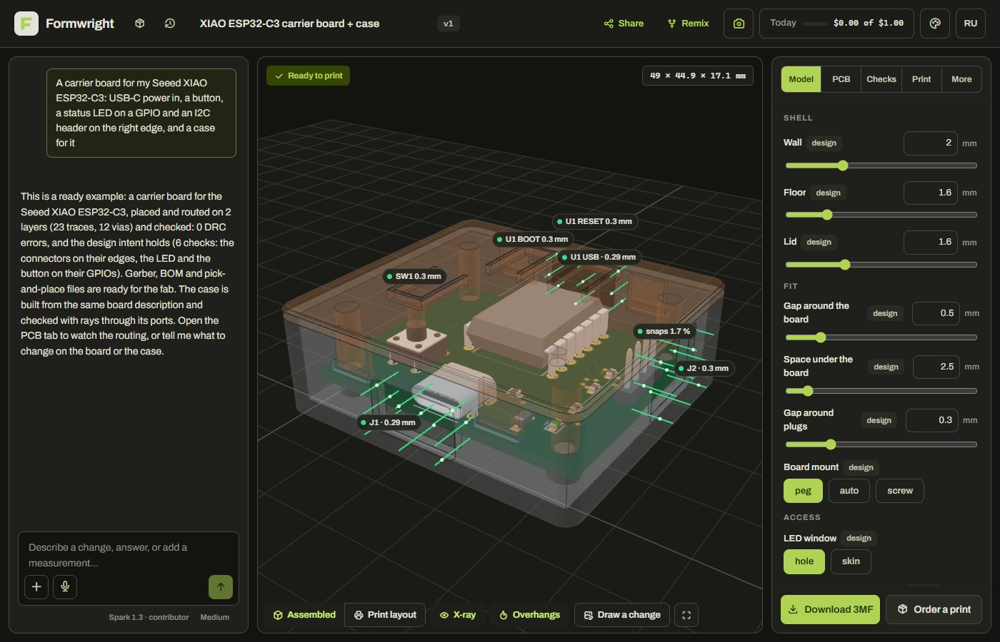

# Formwright

**Formwright by Axo prints the spare part nobody stocks: measured from a photo, verified before you pay, printed on
our farm in Kazakhstan and checked again before it ships.**

Under it is an agent that turns photos, caliper readings, sketches, voice notes and ideas into printable 3D models
(spare parts, cases for electronics boards, the boards themselves) and checks each one against reality before
anything is printed. Dimensions come from measurement, standards tables and official specs, not from guessing: the
agent writes a short parametric program, a geometry kernel builds it, and every version passes a slicer-like
printability check and an independent reviewer.

**[Live app](LIVE_URL)** · **[3-minute video](VIDEO_URL)** · Startups track · Built 27 Oct – 4 Nov 2026 for the Meta
Global AI Developer Hackathon



## Features

- **Spare parts (Formwright Parts).** A photo of the broken part on an A4 sheet, the appliance's rating plate and a
  voice note become an order: the intake reads and refuses what is dangerous to print, the agent designs a compatible
  part from the measured photo, OrcaSlicer gives a binding quote in tenge, the farm prints it, and a QC photo is
  compared with the model before it ships. Every verified part becomes a catalog card that can be reordered.
- **Cases for boards.** A photo of a board is matched to a 13-board dataset (`fw.board/1`); the case is checked with
  rays through every port, press tabs over the buttons and snaps that must not overbend.
- **Boards from a description.** tscircuit in a sandboxed worker: placement, autorouting, DRC and intent checks,
  Gerber/BOM/pick-and-place, and a case around the routed board.
- **Snap & collect.** On a phone, tap anything (a bench, a statue, a cat): it becomes a 3D sticker in about a second,
  and six finds print on one plate.
- **Measurement from photos.** SAM 3.1 finds the part and a known reference (A4/Letter sheet, bank card, coin);
  outlines and holes come out in millimetres with an uncertainty. Caliper displays are read directly.
- **Parametric programs and a mesh engine.** Each model is a JavaScript program with sliders, or a mesh document for
  organic shapes. The same code runs in the browser for live editing and in a sandboxed server worker.
- **Checks.** A layer-by-layer mini-slicer reports islands, bridges, overhangs and thin features; the critic sees
  renders and the model over the photo, never the code.
- **Output.** STL and 3MF with print settings, orders through Formwright Parts, and a Telegram bot.

## Meta models

| Model | Role |
|---|---|
| Muse Spark 1.3 | designer, spare-part intake and refusals, circuits, board identification, caliper reading, dimension search |
| Muse Spark Open (open weights, Baseten) | independent critic, classification, the English layer, second opinion on spare-part requests |
| Muse Wonder | designer for hard parts |
| SAM 3.1 | measurement, board scan, Snap stickers, face blur, QC of printed parts |
| Muse Spark 1.2 | video understanding |
| Muse Voice Transcribe | voice notes |
| Muse Image | concept images and drawn edits |

The open model never decides a refusal: in the shop it can only hold an order for the operator. Self-hosting
instead of Baseten: Muse Glimmer on Modal, `infra/modal_glimmer.py`.

## Built during the hackathon

All code in this repository was written during the building period; the first commit is `bd5ab1b` (27 Oct 2026,
11:01 ET). What existed before is Axo ([axo.kz](https://axo.kz)), the founder's 3D-printing business in Kazakhstan:
its farm, its customers and its own code, none of which is here. `integrations/axo.py` can call Axo's external order
API.

Not ours: the open-source libraries in the `package.json` files and `server/pyproject.toml`; OrcaSlicer, run as an
external CLI; the Archivo font and Tabler Icons (`web/static/fonts/NOTICE.md`); the board dimensions in
`packages/geom/src/boards.json`, taken from the manufacturers' published drawings (each board links its source).

## Architecture

```
 browser (SvelteKit, three.js)              server (FastAPI, SQLite)
 ┌─────────────────────────────────┐  SSE  ┌─────────────────────────────────────────────┐
 │ studio: chat, 3D view, sliders, │◄──────│ agent loop (Muse Spark / Wonder, tools)     │
 │ handles, photo AR, PCB tab,     │       │  ├ packs: household … enclosure, pcb        │
 │ board ghost and port rays       │       │  ├ vision: SAM 3.1, calibration, board scan │
 │ /parts /orders /ops (Axo farm)  │       │  ├ knowledge: standards, web search         │
 │ /snap /collection               │       │  ├ critic: renders + photos, no code        │
 │ geometry workers (same code) ───┼──┐    │  ├ memory: interfaces, lessons, skills      │
 └─────────────────────────────────┘  │    │  └ printing: Orca CLI, profiles, probes     │
                                      │    │ shop: intake, quotes, orders, QC, catalog   │
     packages/geom (TypeScript)       │    │ sandboxed Node workers (vm + permissions):  │
     manifold kernel, lib.elec,       ├────┤  ├ geometry: packages/geom                  │
     checks, renderer, 3MF export ────┘    │  └ PCB: packages/pcb (tscircuit bundle)     │
                                           └─────────────────────────────────────────────┘
```

## Running locally

Requirements: Node 24, Python 3.12+, a Meta Model API key; OrcaSlicer (quotes and slicing) and ffmpeg (audio and
video) are optional. Copy `.env.example` to `.env` and set `META_API_KEY`; the other settings are listed there.

Windows, API on port 8400 and the web app on http://localhost:5400:

```powershell
.\dev.ps1            # the first run installs npm and Python dependencies and builds the PCB worker
```

By hand:

```bash
npm install
cd packages/pcb && npm ci --ignore-scripts && npm run bundle && cd ../..   # the sandboxed PCB worker
cd server
python -m venv .venv && .venv/Scripts/pip install -e ".[dev]"            # .venv/bin/pip on Linux/macOS
.venv/Scripts/python -m uvicorn formwright.app:app --port 8400
npm run dev                                                               # second terminal, repo root
```

On a VPS with HTTPS (Docker and a domain pointing at the server):

```bash
cd deploy && cp .env.template .env && chmod 600 .env   # FW_DOMAIN, META_API_KEY, FW_OPEN_*
docker compose up -d --build
bash smoke.sh https://your.domain
```

## Tests

```bash
npm test                                     # geometry kernel, checks, cases and port rays, stickers, sandbox
cd packages/pcb && npm test                  # the PCB pipeline
cd web && npm test                           # web helpers
cd server && .venv/Scripts/python -m pytest  # vision, printing, agent, shop, PCB, sessions, quotas
```

The server tests stub the models. `tests/test_vision_live.py` and `tests/test_meta_live.py` (with
`FW_LIVE_TESTS=1`) call the real API.

## License

Source-available under [PolyForm Noncommercial 1.0.0](LICENSE): free for judging, personal, research and education
use; commercial use needs permission. Models you create with Formwright are yours.
